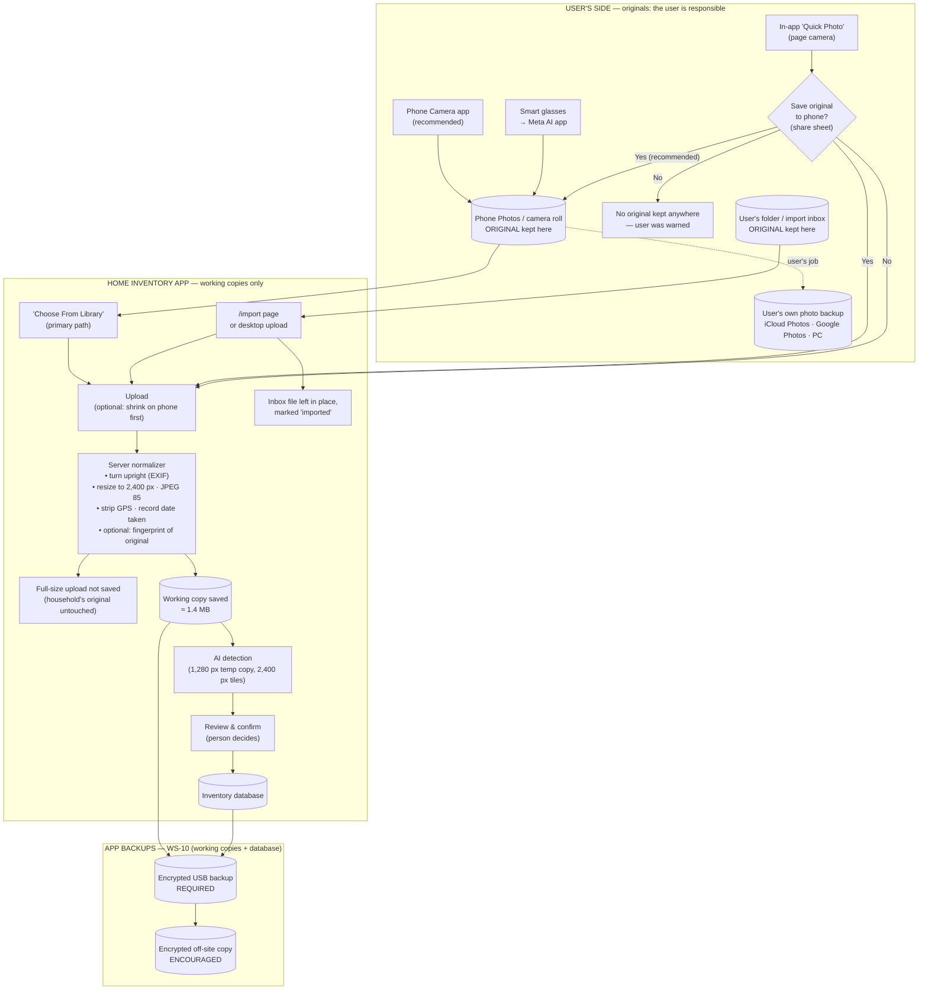

# User-Owned Originals — Capture Change (WS-11)

*Supporting analysis for workstream **WS-11** and proposed decisions **PD-13, PD-14, PD-15** in [GOALS.md](GOALS.md). Everything here is `PROPOSED` until spike SP-10 confirms the iPhone behavior it depends on.*

- **Raised:** 2026-11-24, owner direction: "change how image capture works, so that we do not keep their originals. Users should be responsible for their originals and their backups of their originals."

---

## 1. Today vs Target

| | Today | Target |
|---|---|---|
| What the app stores | The **original upload**, untouched (about 5.35 MB average for the owner's photos) | A **working copy** only: 2,400 px on the long edge, JPEG quality 85 (**measured: 1.42 MB average, 74% smaller**) |
| Where the original lives | **In-app "Take Photo"** (the main path): *only* in the app. iPhone does not save in-page camera photos to the camera roll. | **Always on the user's side:** phone Photos, iCloud/Google Photos, or their own folder. The user is responsible for it and its backup. |
| Inbox import (glasses, desktop) | The file is *moved* out of the inbox into app storage | The inbox file is **left in place** and marked imported. It's the user's file, and the user deletes it when they choose. |
| Backup size for 3,000 photos | about 16 GB | about **4.3 GB**, which fits free cloud tiers (see [DATA_PROTECTION.md](DATA_PROTECTION.md)) |
| Photo GPS location | Kept inside the stored file | **Removed** from the working copy (privacy); date taken is kept in the database |

---

## 2. Target Workflow



**Reading the diagram:** everything in the left box belongs to the user. The app never stores or backs up originals. Everything the app keeps, and therefore everything WS-10 backs up, is the right box: working copies and the database.

### Plain-text version (for viewers without Mermaid)

```text
USER'S SIDE (originals — user's responsibility)          APP (working copies only)
--------------------------------------------------      ---------------------------------------------
Camera app / glasses ──► Phone Photos (ORIGINAL) ──────► Choose From Library ─┐
                              │                                               │
                              └─► user's own photo backup                    ▼
                                                                             Upload
In-app Quick Photo ──► "Save to phone?" ── yes ─► Phone Photos ─┐             │
                              │                                  └──────────►│
                              └── no ─► (no original anywhere) ─────────────►│
                                                                             ▼
User folder / inbox (ORIGINAL stays) ──► /import ──────────────► Server normalizer
                                           └─► inbox file marked   (upright, 2,400 px, JPEG 85,
                                               "imported", kept     strip GPS, keep date taken)
                                                                      │            │
                                                                      ▼            ▼
                                                       Full-size not saved  Working copy (~1.4 MB)
                                                                                   │
                                                                AI detection ◄─────┘
                                                                     ▼
                                                                Review & confirm ─► Inventory DB
                                                                                   │
                                            WS-10 backups: Encrypted USB (required) ─► Off-site (encouraged)
```

---

## 3. Proposed Decisions

### PD-13 — The app stores working copies, never originals
- **Working copy spec:** longest edge 2,400 px (matches `VISION_TILE_SOURCE_DIMENSION`, so deep-scan tiling loses nothing), JPEG quality 85, upright orientation applied, **GPS removed**. Date taken and original filename are recorded in the database so the user can find their original.
- **Only the working copy is saved.** The app reads the upload, makes the working copy from it, and never saves the full-size file to disk. The household's original, on their phone or computer, is not touched.
- **Optional fingerprint:** store a SHA-256 hash of the original. The user can later prove a working copy came from a specific original they kept (useful in an insurance claim) without the app keeping the original.
- **Why:** the owner's direction; 74% less storage, which makes the free backup tiers in WS-10 realistic; less sensitive data held (no GPS); a clear line of responsibility.
- **Trade-off accepted:** the app's copy is lower-resolution evidence than the original. If the user loses their original, only the working copy remains.

### PD-14 — Capture paths
- **"Choose From Library" becomes the primary, recommended path.** Users take photos with the phone's Camera app (originals land in Photos) and then pick them in the app. The capture page is reordered and reworded to match.
- **In-app camera becomes "Quick Photo".** After each shot it offers **"Save original to my phone"** through the iPhone share sheet ("Save Image"). If the user declines, it says plainly that no full-size original will exist anywhere. The leaning is to keep it for speed; the option of removing it is decided after SP-10.
- **Inbox import never moves or deletes the user's files.** Imported files are recorded (name + fingerprint) so they aren't imported twice.
- **Optional enhancement:** shrink the photo **on the phone before upload**, so the original never leaves the phone at all (better privacy, faster upload on Wi-Fi). The server normalizer still runs regardless, because desktop and inbox paths need it.

### PD-15 — Photos already stored
- Existing stored originals are **left as they are by default.** Some of the owner's photos were taken with the in-page camera and **exist nowhere else**.
- An optional, one-time **"Compact existing photos"** tool converts them to working copies. It runs only after a verified backup and asks for confirmation. It warns clearly that the full-size copies stored in the app will be replaced, and that anyone without their own copy of those photos should save them first.

---

## 4. Effects on Other Workstreams

| Workstream | Effect |
|---|---|
| WS-2 Insurance records | Evidence photos are working copies. Close-up serial/model reading must work at 2,400 px; SP-2 now tests at that size. Reports state that originals are held by the household. |
| WS-3 Client report | Report thumbnails come from working copies (no change). Disclaimer adds "original photos are held by the household". |
| WS-6 Field efficiency | The field queue holds working copies. In field mode, originals stay on the phone or camera that took them. |
| WS-9 Licensing | The user guide and EULA state that the household is responsible for original photos and their backup. |
| WS-10 Data protection | Backups cover working copies + database only. Size estimate drops from about 16 GB to about **4.3 GB** per 3,000 photos, so the customer's free Google Drive (15 GB) covers most homes. |
| BL-003 Crop regions | Crops come from 2,400 px working copies. Recorded in the backlog item. |

---

## 5. SP-10 — Spike Checklist (iPhone behavior, 2 h)

1. With **Choose From Library**, does Safari upload the full-resolution image? Does it convert HEIC → JPEG? Is the date taken still readable?
2. Does the **Web Share API** with a file offer "Save Image" on iPhone Safari after an in-page capture? Is it reliable enough to recommend?
3. Does **in-browser resizing** (canvas / `createImageBitmap`) keep orientation correct on iPhone? How much upload time does it save?
4. Confirm **working-copy size** on 20+ fresh photos (expect about 1.4 MB at 2,400 px).
5. With SP-2: can serial/model stickers be read at 2,400 px?

Result: PD-13 and PD-14 marked ACCEPTED, or revised, in DECISIONS.md.

---

## 6. Wording for Customers

Customers must not come away thinking the app deletes their photos. It never touches them; it simply doesn't save a second full-size copy. Every screen, the user guide and the EULA use this wording.

**Say:**
- "Your original photo stays on your phone (or computer). Home Inventory saves a smaller working copy for your inventory."
- "Home Inventory doesn't keep a full-size copy of your photos. Keep your originals in your phone's Photos or your own photo backup."
- After a Quick Photo: "This photo was taken inside the app, so it isn't in your phone's Photos. Tap **Save Image** to keep a full-size copy."
- For the import inbox: "Your files stay where they are. Home Inventory makes working copies and marks the files as imported."

**Don't say:** "discard", "delete", "remove", "throw away" or "strip" about the user's photos or originals. In technical documents, describe the mechanism instead: "the app reads the upload, makes the working copy from it, and never saves the full-size file to disk."

The one real removal, PD-15 compaction of photos *already stored in the app*, is described exactly as what it is: "replace the full-size copies stored in Home Inventory with working copies".
